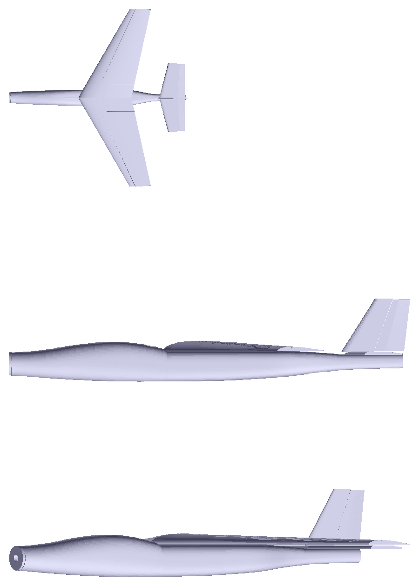
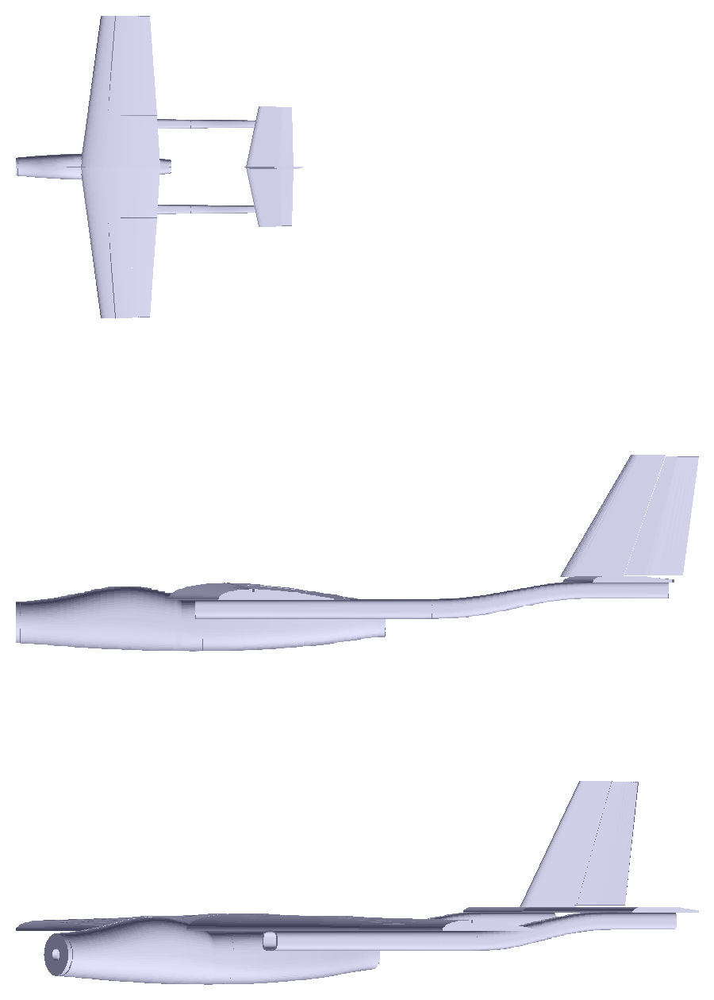
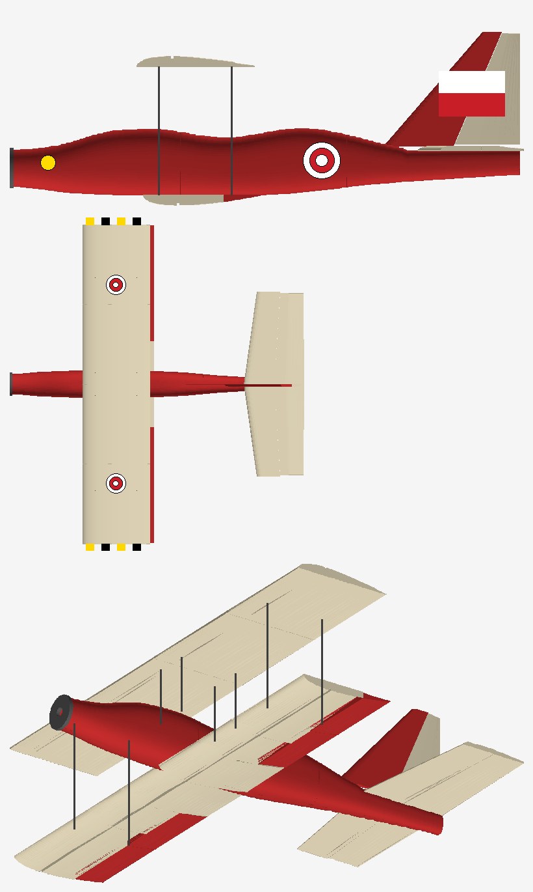
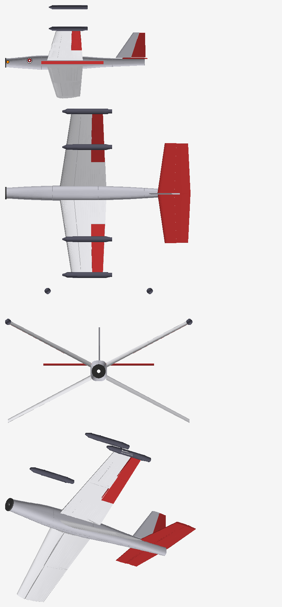
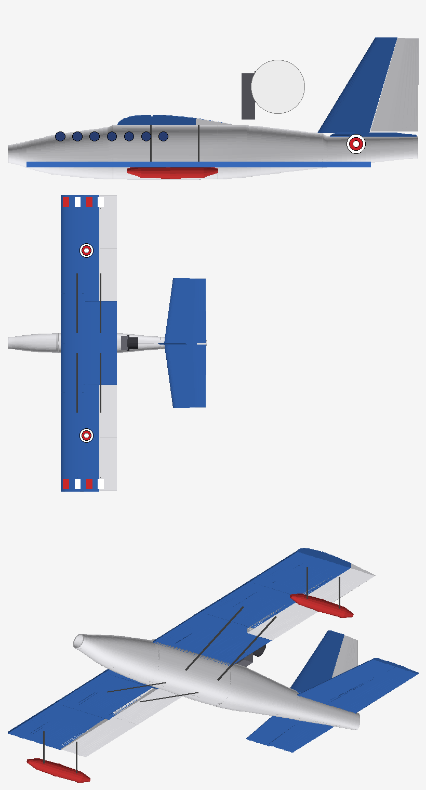

# RC Aircraft Designs (showcase)

Six small RC aircraft I designed from scratch for 3D printing and foam board. Each plane is generated by Python scripts (NumPy), so changing a few parameters rebuilds every print-ready STL part, the A4 foam-board templates and the sticker sheets.

> **This is a showcase repository.** The generators, STL files and templates are private. Request access via [LinkedIn](https://id.linkedin.com/in/ferdinand-klasse).

| Design | Type | Notes |
|---|---|---|
| **Falcon Swift** | Swept-wing sport jet | 520 mm span, 30° sweep, CG at 25–30% MAC |
| **Vampire** | Twin-boom, nose prop | 530 mm span, 6.0 dm² wing area |
| **Capung** | Small biplane | 450 mm span, aileron on the lower wing |
| **Bintang** | Four-wing X layout | Inspired by an X-wing, original design; upper wings +28°, lower wings -28° |
| **Camar** | Flying-boat style | 640 mm high wing, pusher motor on a pylon |
| **Cessna profile** | Foam-board trainer | A4 template set |

Falcon Swift, Vampire, Capung, Bintang and Camar share one design: conventional aileron, elevator and rudder control, so a standard 6-axis gyro board works without changing the mixing.

## Previews
| | |
|---|---|
|  |  |
|  |  |
|  | |

## What each design includes
- Print-ready STL parts that fit a 145 mm bed, laid flat (Bintang, Camar and Capung have 25–28 parts each)
- 1:1 A4 foam-board templates with component placement
- A one-page A4 sticker sheet
- Python generator scripts

Weights and flight performance are estimates from the scripts, not measurements.

## Tech
Python, NumPy, Pillow, STL export, FDM printing (LW-PLA, PETG).

## License
Copyright (c) 2026 Ferdinand Klasse. All rights reserved.

No permission is granted to copy, modify, distribute, or use this material or the related source code without written permission from the author.
